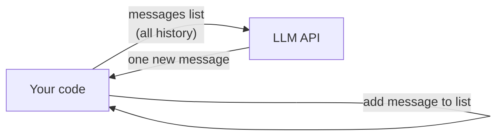
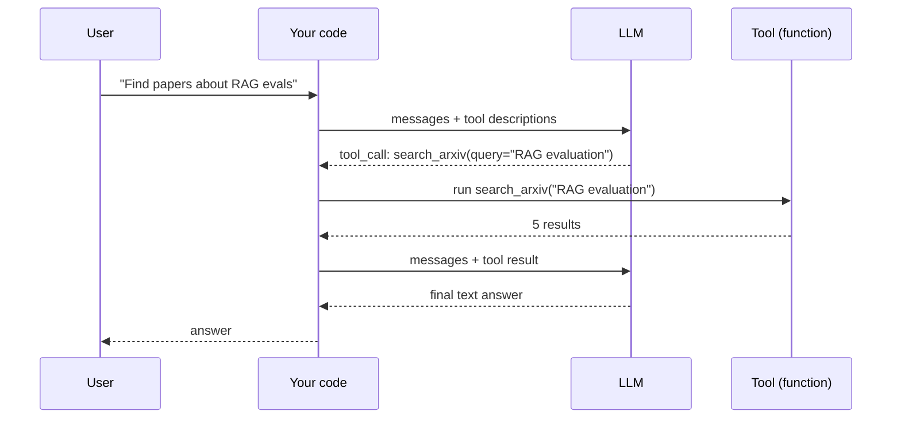
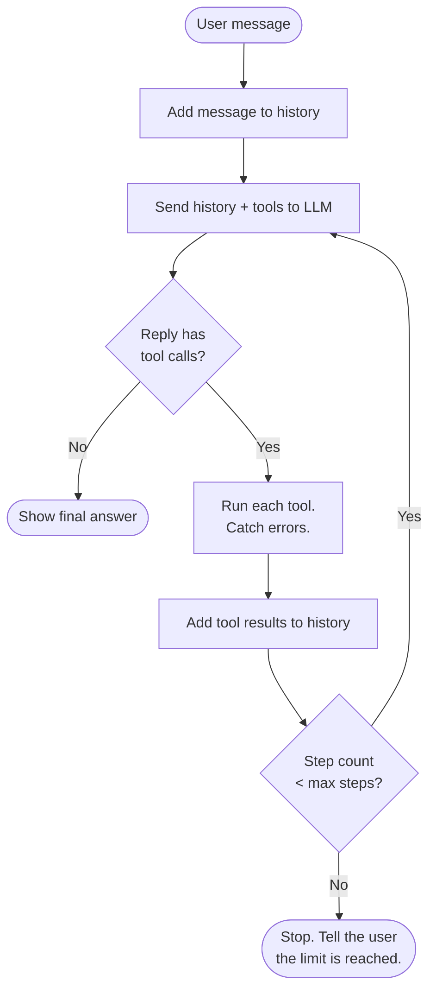
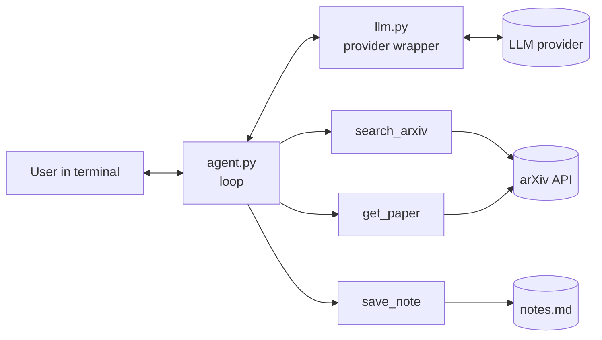

# Stage 1: Agent from Scratch

**Time:** week 1, about 20 hours · **Framework:** none · **AI coding assistant:** permitted for all files except `agent.py` (see rule below)

> **AI rule:** You can use AI to generate code. You design it, you review it, and you must explain each line. At the end of the stage, do one 30-minute drill: rebuild `agent.py` from a blank file without AI (interview practice).

> Writing rule: ASD-STE100. Short sentences. Imperative instructions.

> **Start here:** follow [TASKS.md](TASKS.md), one small task at a time.

---

## Part 0: Setup (do this first, about 30 minutes)

The mentor already made these files: `llm.py`, `tools.py`, `main.py`, `.env`, `requirements.txt`, `NOTES.md`.
You write only `agent.py`. It has TODO comments to guide you.

**Step 1.** Install Ollama. Download it from https://ollama.com/download and open the app.

**Step 2.** Download the model (about 5 GB). In Terminal, type:

```bash
ollama pull qwen3:8b
```

**Step 3.** Make sure that the model works:

```bash
ollama run qwen3:8b "Say hello in one sentence"
```

**Step 4.** Go to the project folder. Install the 2 Python packages into the `.venv` folder (already created).

```bash
cd ~/Desktop/projects/AI/projects/01-agent-from-scratch
```

```bash
uv pip install -r requirements.txt
```

**Step 5.** Start the program:

```bash
uv run main.py
```

Before you finish `agent.py`, you see `NotImplementedError`. This is correct. Now complete the TODOs.

**Step 6.** Make the folder a Git repository and push it to GitHub (your proof of work).

---

## Part A: Lesson (revision)

### A1. What an LLM does

An LLM (Large Language Model) receives text. It predicts the next token. It does this again and again.
A **token** is a part of a word. One English word is approximately 1.3 tokens. Arabic text uses more tokens.
The LLM has no memory. Your code must send all the conversation each time.



### A2. Messages

A request contains a list of **messages**. Each message has a **role**.

| Role | Who writes it | Use |
|---|---|---|
| `system` | You (developer) | Rules and persona. The LLM reads it first. |
| `user` | The human | The question or the task. |
| `assistant` | The LLM | The answer, or a request to use a tool. |
| `tool` | Your code | The result of a tool. |

The **context window** is the maximum number of tokens in one request. When the history becomes too long, you must cut it or summarize it.

### A3. Important settings

- **temperature:** Low value (0–0.3) gives stable answers. Use a low value for agents and RAG.
- **max_tokens:** The maximum length of the answer. It also controls cost.
- **Structured output:** Tell the LLM to reply in JSON that agrees with a schema. Then your code can read the reply safely.

### A4. Tool calling

A **tool** is a function in your code. You send the LLM a description of the tool (name, purpose, JSON schema of the arguments).
The LLM does not run the tool. The LLM only asks your code to run it. Your code runs it and sends back the result.



### A5. The agent loop

An **agent** is an LLM in a loop. It can use tools. It decides the next step itself.
The loop stops when the LLM gives a final answer, or when the loop reaches the step limit.



Three rules for a safe loop:
1. Always set a **max steps** limit. An agent without a limit can loop forever and spend money.
2. When a tool fails, do not crash. Send the error text to the LLM as the tool result. The LLM can then try again.
3. The LLM can ask for **more than one tool call** in one reply. Run all of them. Send all results back.

### A6. Workflow or agent?

Do not use an agent for all tasks. An agent is slower, more expensive, and less predictable.

| Use a **workflow** (fixed steps in code) when... | Use an **agent** when... |
|---|---|
| The steps are always the same. | The steps change for each task. |
| You need speed and low cost. | The task needs decisions and retries. |
| Example: summarize each new paper. | Example: "Find the best method for X and compare it with Y." |

---

## Part B: Build

### B1. The task

Build `paperpilot`, a CLI agent. It talks with the user about arXiv papers.



### B2. Tools

| Tool | Arguments | It returns |
|---|---|---|
| `search_arxiv` | `query: str`, `max_results: int = 5` | id, title, authors, date for each result |
| `get_paper` | `arxiv_id: str` | title, abstract, authors, PDF link |
| `save_note` | `title: str`, `text: str` | "saved" or an error |

Use the free arXiv API: `http://export.arxiv.org/api/query?search_query=all:<query>&max_results=5`. It returns Atom XML.

### B3. Files

```
projects/01-agent-from-scratch/
├── README.md        (this file)
├── llm.py           # one function: chat(messages, tools) -> reply
├── tools.py         # the 3 tools + their JSON schemas
├── agent.py         # the loop (write this by hand)
├── main.py          # CLI: read input, call agent, print answer
├── NOTES.md         # your answers to Part C + time log
├── .env.example
└── requirements.txt
```

### B4. Acceptance criteria

Make sure that all of these are true:

- [ ] The agent keeps the conversation history between turns.
- [ ] The agent can run 2 or more tool calls from one LLM reply.
- [ ] A tool error (for example, a bad arXiv id) does not crash the program. The LLM receives the error text.
- [ ] The loop stops after `MAX_STEPS = 6`.
- [ ] The program prints each tool call and its arguments (this is your simple trace).
- [ ] The program prints the token count of each request.
- [ ] Only `llm.py` imports the provider SDK. You can change the provider in one file.
- [ ] No API key is in Git.

### B5. Test conversation

Run this conversation. Paste the output in `NOTES.md`.

1. "Find 3 recent papers about evaluating RAG systems."
2. "Get the abstract of the second one and save a note with its main idea."
3. "Get paper 9999.99999." (This id is not valid. The agent must handle the error.)

---

## Part C: Check your knowledge

Write short answers in `NOTES.md`. Use your own words. Do not search first.

1. Why must your code send all the history in each request?
2. What is the difference between the `assistant` message with a tool call and the `tool` message?
3. What can happen if you do not set a step limit?
4. Give one task where a workflow is better than an agent. Explain why.
5. How does a framework like LangChain hide the loop from Part A5?

---

## Part D: Send for review

When you finish, tell the mentor: "Stage 1 done." Include:
- The time you used for `agent.py`
- The test output
- Your answers to Part C
- One thing that was difficult

The mentor reviews the code. Then the mentor gives you Stage 2 (RAG core).
