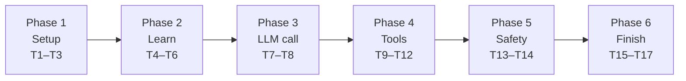

# Stage 1 Tasks

Do the tasks in this sequence. Do one task at a time.
Each task is small (15 to 90 minutes). Each task has a test.
When a task is done, change `[ ]` to `[x]`.

> If a task fails for more than 30 minutes, stop. Send the mentor your code and the error.



---

## Phase 1: Setup

### [x] T1. Install Ollama and the model
Done. `ollama run qwen3:8b` works.

### [x] T2. Install the Python packages (5 min)
**Do:** In Terminal, in the project folder, type:
```bash
uv pip install -r requirements.txt
```
**Test:**
```bash
uv run python -c "import openai, dotenv; print('ok')"
```
**Done when:** You see `ok`.

### [x] T3. Make a Git repository (10 min)
**Do:**
```bash
git init
```
```bash
git add .
```
```bash
git commit -m "Stage 1: starter files"
```
**Test:** `git status` shows "nothing to commit". The `.env` file is NOT in Git (`.gitignore` excludes it).
**Done when:** You have your first commit.

---

## Phase 2: Learn

### [ ] T4. Read the lesson (60 min)
**Do:** Read Part A of [README.md](README.md). Look at each diagram.
**Done when:** You can explain the agent loop diagram (A5) to yourself without the text.

### [ ] T5. Answer the knowledge questions (30 min)
**Do:** Write the answers to Part C in [NOTES.md](NOTES.md). Use your own words. Do not search.
**Done when:** All 5 answers are written. It is OK if some are wrong. The mentor will correct them.

### [ ] T6. Read the starter code (30 min)
**Do:** Read `llm.py`, `tools.py`, and `main.py`. Then run a tool by itself:
```bash
uv run python -c "from tools import search_arxiv; print(search_arxiv('RAG evaluation', 2))"
```
**Test:** You see 2 papers with titles and ids.
**Done when:** You can answer these questions:
- What does the `chat()` function return?
- What is the difference between `TOOLS` and `TOOL_SCHEMAS`?

---

## Phase 3: The first LLM call (TODO 1)

### [x] T7. Make the LLM reply with text (30 min)
**Do:** In `agent.py`, in `run()`:
1. Add the user message to `self.messages` (a dict with `role` = `"user"` and `content`).
2. Call `chat(self.messages)`. Do NOT send tools yet. You get `message, usage`.
3. Add `message.model_dump(exclude_none=True)` to `self.messages`.
4. Return `message.content`.

Remove the line `raise NotImplementedError("Write the agent loop")`.

**Test:** Run `uv run main.py`. Type:
- `Hello, my name is Nour.`
- `What is my name?`

**Done when:** The second answer says "Nour". This proves that the history works.
**Commit:** `git commit -am "T7: first LLM call with history"`

### [x] T8. Print the token count (15 min)
**Do:** After the `chat()` call, print `usage.total_tokens`.
**Test:** Send 3 messages. Look at the numbers.
**Done when:** You see the number get larger with each message. Write in NOTES.md **why** it gets larger. (Hint: what do you send each time?)
**Commit.**

---

## Phase 4: Tools (TODOs 2 and 4)

### [x] T9. See a tool call, but do not run it (30 min)
**Do:**
1. Change the call to `chat(self.messages, TOOL_SCHEMAS)`.
2. After the call, print `message.tool_calls`.
3. Do not run the tools yet.

**Test:** Type `Find 2 papers about RAG evaluation.`
**Done when:** You see a tool call with the name `search_arxiv` and its arguments. Copy one printed tool call into NOTES.md. Find these 3 parts in it: `id`, `function.name`, `function.arguments`.

> The program can fail after the print, because the LLM expects a tool result. That is normal at this step.

### [x] T10. Write `_run_tool()` for the normal case (30 min)
**Do:** In `_run_tool(name, arguments_json)`:
1. Get the function from `TOOLS` with the name.
2. Change `arguments_json` from a string to a dict with `json.loads()`.
3. Call the function with the dict: `func(**args)`.
4. Return the result as a string with `json.dumps()`.

**Test:**
```bash
uv run python -c "from agent import Agent; print(Agent()._run_tool('get_paper', '{\"arxiv_id\": \"2005.11401\"}'))"
```
**Done when:** You see the title "Retrieval-Augmented Generation for Knowledge-Intensive NLP Tasks".
**Commit.**

### [x] T11. Write the agent loop (60–90 min) ⭐ the most important task
**Do:** Follow TODO 2 in `agent.py`:
1. Put the LLM call in a `for step in range(MAX_STEPS):` loop.
2. Add the assistant message to the history.
3. If `message.tool_calls` is empty: return `message.content`.
4. For each tool call: run `_run_tool()`, then add a message with `role` = `"tool"`, `tool_call_id` = `call.id`, and `content` = the result.
5. The loop then calls the LLM again with the results.

**Test:** Type `Find 3 recent papers about evaluating RAG systems.`
**Done when:** You get an answer with 3 real papers and their arXiv ids.
**Commit:** `git commit -am "T11: agent loop with tools"`

### [x] T12. Test many tools in one request (20 min)
**Do:** No new code. Only test.
**Test:** Type `Find a paper about reranking, read its abstract, and save a note with its main idea.`
**Done when:** `notes.md` contains a new note. If it does not work, find out why and fix it.

---

## Phase 5: Safety (TODOs 3 and 4)

### [x] T13. Handle tool errors (30 min)
**Do:** In `_run_tool()`, use `try / except`. Never let an error escape. Return a string that starts with `ERROR:` for these 3 cases:
1. The tool name is not in `TOOLS`.
2. `json.loads()` fails (bad JSON).
3. The tool raises an exception (for example, a bad paper id).

**Test:**
```bash
uv run python -c "from agent import Agent; a=Agent(); print(a._run_tool('get_paper', '{\"arxiv_id\": \"abc\"}')); print(a._run_tool('fly', '{}')); print(a._run_tool('get_paper', 'not json'))"
```
Then in the chat, type `Get paper 9999.99999.`
**Done when:** You see 3 `ERROR:` lines. The program does not crash. In the chat, the agent explains the error to the user.
**Commit.**

### [ ] T14. Add the step limit message (15 min)
**Do:** After the loop ends (TODO 3), return a clear message, for example: "I stopped because I reached the limit of 6 steps."
**Test:** For this test only, change `MAX_STEPS` to `1`. Type `Find a paper about RAG and save a note.` Then change `MAX_STEPS` back to `6`.
**Done when:** You see your limit message.
**Commit.**

---

## Phase 6: Finish

### [ ] T15. Add a trace (15 min)
**Do:** Before you run each tool, print the tool name and the arguments, for example:
`  [tool] search_arxiv {"query": "RAG evaluation"}`
**Done when:** You can see each step of the agent in the Terminal.
**Commit.**

### [ ] T16. Run the full test (30 min)
**Do:** Restart the program. Run the test conversation in Part B5 of [README.md](README.md). Paste all the output in NOTES.md. Fill in the time log.
**Done when:** All 8 acceptance criteria in Part B4 of README.md are true.

### [ ] T17. Push to GitHub and send for review (20 min)
**Do:**
1. Make a new public repository on GitHub with the name `paperpilot`.
2. Push your code.
3. Tell the mentor: **"Stage 1 done"**. Include the GitHub link and the NOTES.md content.

**Done when:** The mentor has your work. 🎉

---

## Time estimate

| Phase | Time |
|---|---|
| 1. Setup | 15 min |
| 2. Learn | 2 h |
| 3. LLM call | 45 min |
| 4. Tools | 3 h |
| 5. Safety | 45 min |
| 6. Finish | 1 h |
| **Total** | **about 8 hours** |

You have 20 hours this week, so you have time for mistakes, questions, and the `/no_think` experiment.
