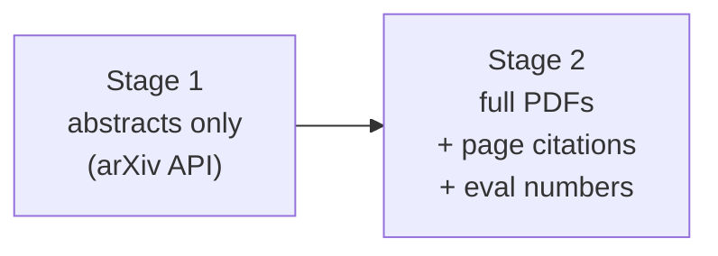
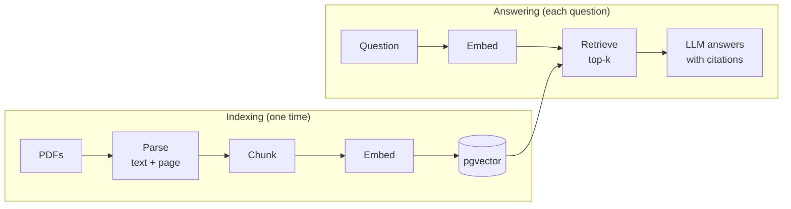
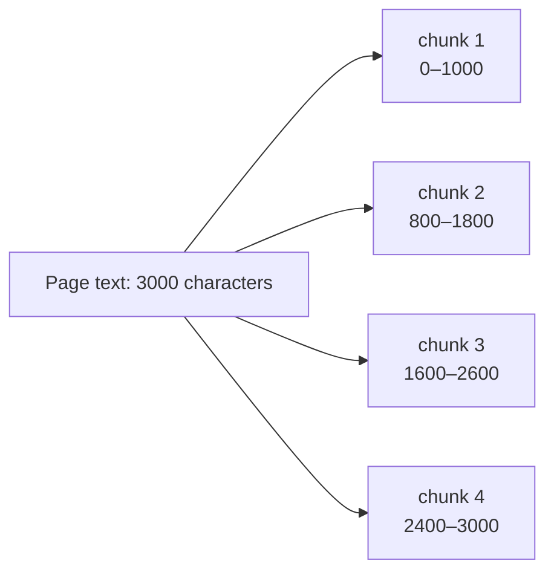
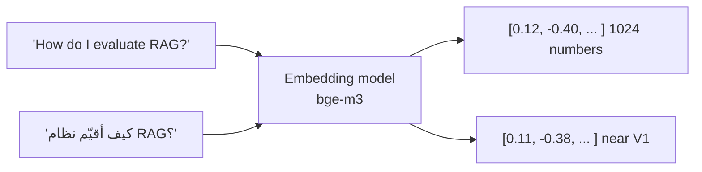
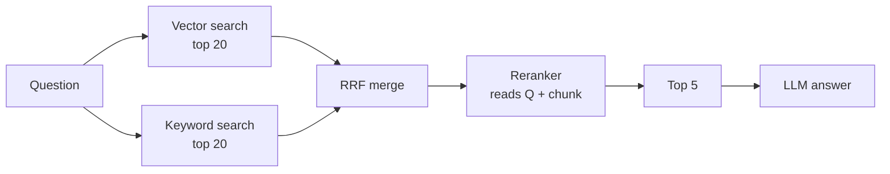
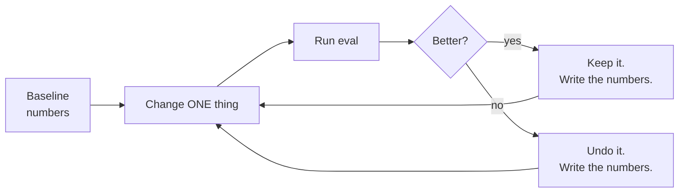
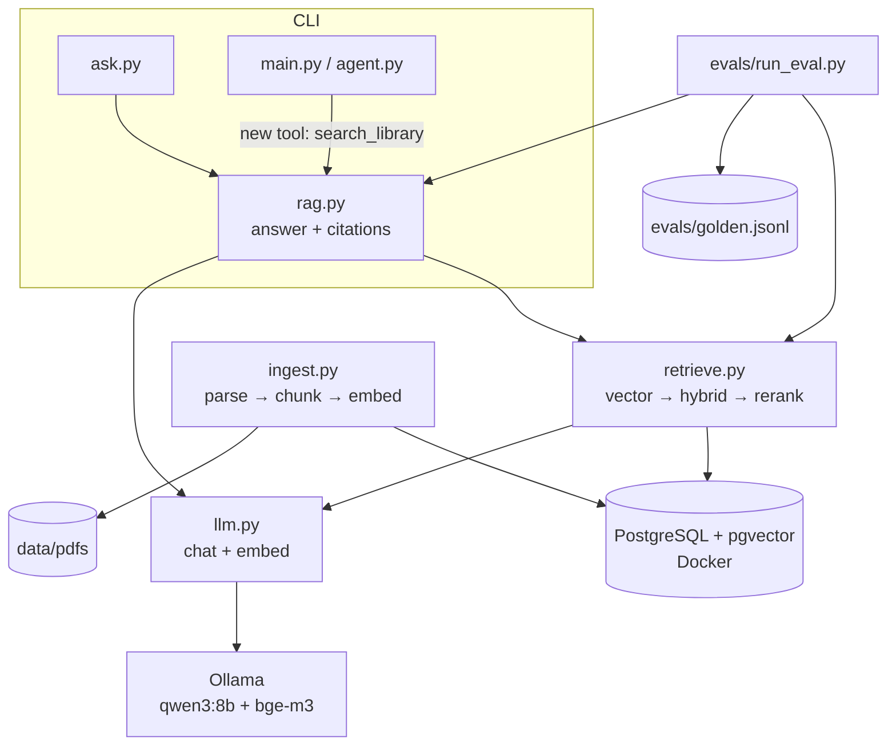

# Stage 2: RAG Core + Evals

**Time:** weeks 2–4, about 60 hours · **Start:** follow [TASKS.md](TASKS.md), one task at a time

> Writing rule: ASD-STE100. Short sentences. Imperative instructions.

---

## The goal of Stage 2

In Stage 1, PaperPilot read only the **abstracts**. In Stage 2, it reads the **full PDFs** of about 40 papers. It answers questions from inside the papers, with a citation: **paper id + page**.

You also **measure** the quality. At the end, your CV has a real line: *"I improved retrieval hit rate@5 from X% to Y%."*



---

## Part A: Lesson (revision)

### A1. Why RAG

An LLM knows only its training data. It does not know your documents. It does not know new papers.
You cannot put 40 full papers in one prompt. That is too many tokens, too slow, and too expensive.

**RAG** (Retrieval-Augmented Generation) solves this:
1. **Retrieve:** find the few small parts of the documents that are related to the question.
2. **Augment:** put only those parts in the prompt.
3. **Generate:** the LLM answers from those parts.

### A2. The two pipelines

RAG has two pipelines. The **indexing** pipeline runs one time, before the questions. The **answering** pipeline runs for each question.



### A3. Parsing

**Parsing** gets the text out of the PDF.
Keep the **page number** with each part of the text. You need it for the citation.
PDF parsing is never perfect. Tables, formulas, two columns, and headers can make the text messy. Always look at some parsed text yourself.

### A4. Chunking

A **chunk** is a small part of a document. You retrieve chunks, not full documents.



- **Chunk size:** the length of each chunk.
- **Overlap:** the shared text between two chunks (200 characters above). It prevents the loss of a sentence that is cut in the middle.

| Chunks too small | Chunks too large |
|---|---|
| Each chunk has too little context | Each chunk contains many topics |
| The answer is split into many chunks | The embedding becomes "average" and less precise |
| | More tokens in the prompt |

There is no correct size for all data. **Measure it.** (Task T19.)

### A5. Embeddings

An **embedding** is a list of numbers (a **vector**) that represents the meaning of a text.
Texts with similar meanings have vectors that are near each other.



- We use **`bge-m3`**. It runs in Ollama, and it is **multilingual**. An Arabic question can find English text.
- **Similarity** is measured with **cosine similarity**: 1 = same direction (same meaning), 0 = not related.
- **Rule:** use the **same** embedding model for the chunks and for the questions. Vectors from different models cannot be compared.

### A6. The vector database (pgvector)

**pgvector** adds a `vector` column type to PostgreSQL. You already know PostgreSQL, so you only learn the vector part.

```sql
CREATE TABLE chunks (
  id        SERIAL PRIMARY KEY,
  arxiv_id  TEXT,
  page      INT,
  content   TEXT,
  embedding VECTOR(1024)
);

-- top 5 chunks nearest to the question vector (<=> is cosine distance)
SELECT arxiv_id, page, content
FROM chunks
ORDER BY embedding <=> :question_vector
LIMIT 5;
```

An **HNSW index** makes this search fast for many rows. With 40 papers, the search is fast without it. Add it to learn it.

### A7. Better retrieval: hybrid search and reranking

Vector search finds **meaning**. It is weak for **exact words**: names, ids, acronyms (for example "MRR", "ColBERT"). Keyword search (full-text search) is strong for exact words.

**Hybrid search** runs both searches and merges the two lists. A simple merge method is **RRF** (Reciprocal Rank Fusion): each chunk gets `1 / (60 + rank)` from each list. Add the scores. Sort.

A **reranker** is a second, more precise model. It reads the question and each chunk **together**, and it gives a better score. It is slower, so use it only on the top 20–50 candidates.



### A8. Generation with citations

The prompt tells the LLM:
1. Answer **only** from the given chunks.
2. Cite each fact like this: `[2005.11401 p.3]`.
3. If the chunks do not contain the answer, say "I don't know". Do not guess.

Rule 3 is important. Without it, the LLM fills the gaps with its own knowledge and invents things. In Stage 1 you saw the model add a wrong "fact" to a tool result.

### A9. Evals: measure, do not guess

You cannot improve what you do not measure. An **eval** is a fixed test set and a script that gives numbers.

**The golden set:** about 30 questions. Each question has the correct paper, the correct page, and a reference answer. You make it **one time**. You use it after **each** change.

| What you measure | Metric | Meaning |
|---|---|---|
| Retrieval | **Hit rate@5** | % of questions where a correct chunk is in the top 5 |
| Retrieval | **MRR** | Mean Reciprocal Rank. 1 = the correct chunk is always first |
| Answer | **Faithfulness** | Does the answer use only facts from the chunks? |
| Answer | **Correctness** | Does the answer agree with the reference answer? |

The answer metrics use an **LLM-as-judge**: a second LLM call that reads the answer and gives a score with a reason.



**Change one thing at a time.** If you change two things, you do not know which one helped.

### A10. Common RAG failures

| You see | Possible cause | First check |
|---|---|---|
| Wrong answer, but the correct chunk was retrieved | Generation problem (prompt, model) | Read the retrieved chunks |
| Wrong answer, and the correct chunk was NOT retrieved | Retrieval problem | Hit rate@5, chunk size, hybrid search |
| Correct facts, but no citation | Prompt problem | The citation rule in the prompt |
| Answer contains facts that are not in the chunks | Low faithfulness | "Only use the chunks" rule, a stronger model |
| Good retrieval for English, bad for Arabic | Embedding model | Use a multilingual model (bge-m3) |

---

## Part B: What you build

### B1. Architecture



### B2. New files

```
paperpilot/
├── docker-compose.yml   # PostgreSQL + pgvector
├── corpus.json          # the list of ~40 paper ids
├── download.py          # downloads the PDFs to data/pdfs/
├── db.py                # connection + table schema
├── ingest.py            # parse → chunk → embed → store
├── retrieve.py          # search functions
├── rag.py               # answer with citations
├── ask.py               # CLI: ask one question
├── evals/
│   ├── golden.jsonl     # ~30 test questions
│   ├── run_eval.py      # gives the numbers
│   └── RESULTS.md       # the table of all experiments
└── data/pdfs/           # NOT in Git
```

### B3. Acceptance criteria for Stage 2

- [ ] ~40 papers are indexed. Each chunk has `arxiv_id` and `page`.
- [ ] `ask.py` answers with citations like `[2005.11401 p.3]`.
- [ ] `ask.py` says "I don't know" when the papers do not contain the answer.
- [ ] A golden set of 30 questions (including 5 Arabic questions).
- [ ] `run_eval.py` prints hit rate@5, MRR, faithfulness, and correctness.
- [ ] `RESULTS.md` shows the baseline and at least 3 measured experiments.
- [ ] The agent from Stage 1 has a new tool, `search_library`.
- [ ] A LangChain version of the pipeline, with a comparison in `RESULTS.md`.
- [ ] No PDFs and no `.env` in Git.
